

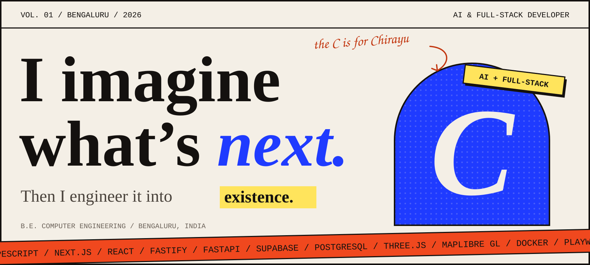

 

  

**I build production-shaped web apps: real databases, real auth, and AI wired into the actual product flow, not a chatbot bolted on the side.**

 

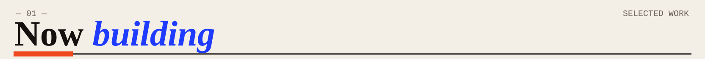

<table>
<tr>
<td width="50%" valign="top">
<a href="https://envoy-i02z.onrender.com/">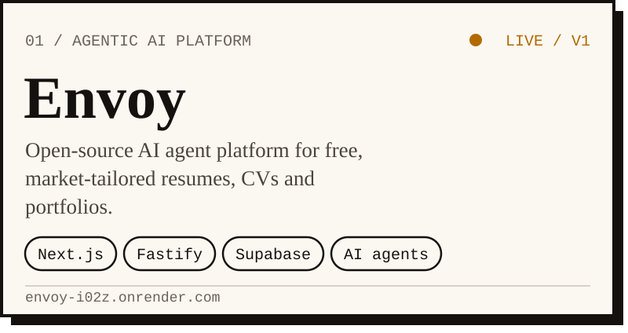</a>
 <b><a href="https://envoy-i02z.onrender.com/">Live ↗</a></b> &nbsp;·&nbsp; <a href="https://github.com/Crusty-chirayu/Envoy">Repo ↗</a>
</td>
<td width="50%" valign="top">
<a href="https://cartiq-five.vercel.app/">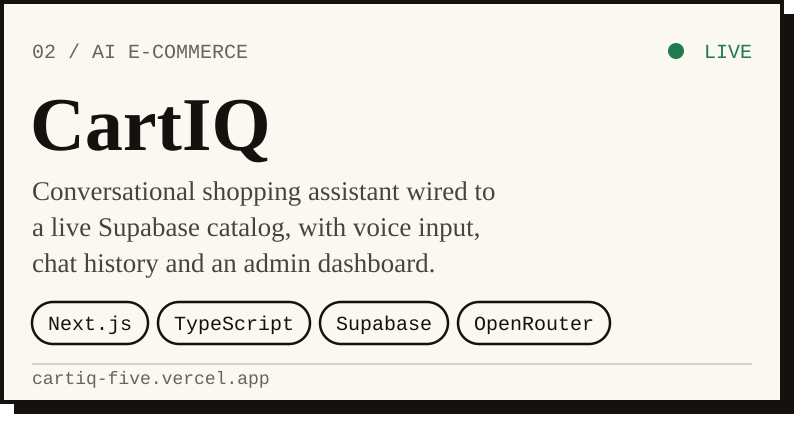</a>
 <b><a href="https://cartiq-five.vercel.app/">Live ↗</a></b> &nbsp;·&nbsp; <a href="https://github.com/Crusty-chirayu/CartIQ">Repo ↗</a>
</td>
</tr>
<tr>
<td width="50%" valign="top">
<a href="https://aeroloom-five.vercel.app">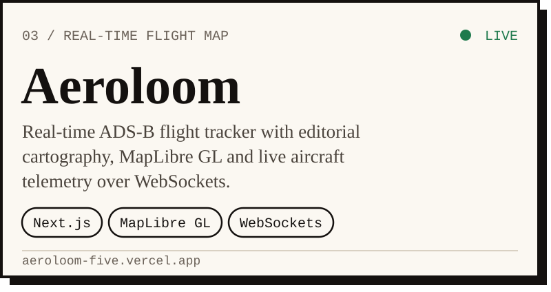</a>
 <b><a href="https://aeroloom-five.vercel.app">Live ↗</a></b> &nbsp;·&nbsp; <a href="https://github.com/Crusty-chirayu/Aeroloom">Repo ↗</a>
</td>
<td width="50%" valign="top">
<a href="https://group-chatbot-ruby.vercel.app/">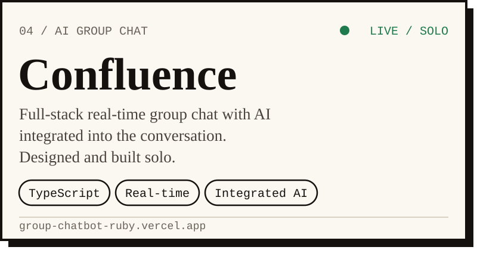</a>
 <b><a href="https://group-chatbot-ruby.vercel.app/">Live ↗</a></b> &nbsp;·&nbsp; <a href="https://github.com/Crusty-chirayu/Confluence">Repo ↗</a>
</td>
</tr>
<tr>
<td width="50%" valign="top">
<a href="https://trailmate-zeta.vercel.app/">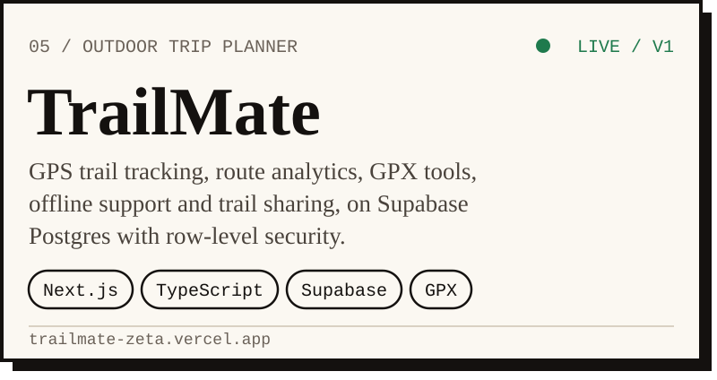</a>
 <b><a href="https://trailmate-zeta.vercel.app/">Live ↗</a></b> &nbsp;·&nbsp; <a href="https://github.com/Crusty-chirayu/Trailmate">Repo ↗</a>
</td>
<td width="50%" valign="top">
<a href="https://aaragate.onrender.com/">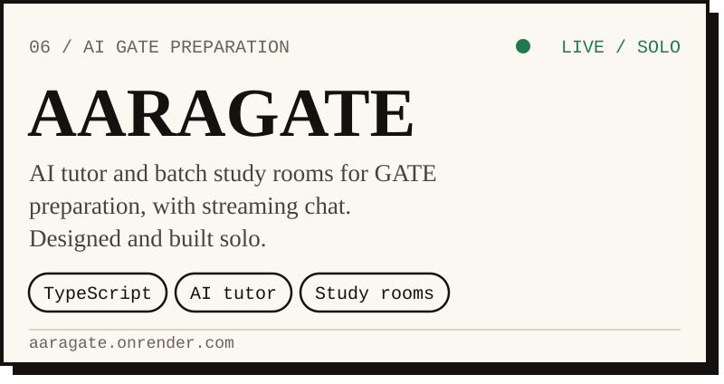</a>
 <b><a href="https://aaragate.onrender.com/">Live ↗</a></b> &nbsp;·&nbsp; <a href="https://github.com/Crusty-chirayu/AARAGATE">Repo ↗</a>
</td>
</tr>
</table>

**In development** &nbsp;/&nbsp; **FaceGate**, a face-recognition attendance API growing into a full-stack dashboard ([repo](https://github.com/Crusty-chirayu/Face-Recognition)) &nbsp;·&nbsp; **Weave**, a local-first knowledge management app (private for now)

**Also built** &nbsp;/&nbsp; [Atmos](https://atmos-zeta-ten.vercel.app), AI weather intelligence with real-time forecasts &nbsp;·&nbsp; [Scrappy](https://scrappy-alpha-taupe.vercel.app) &nbsp;·&nbsp; [Edu-Share](https://github.com/Crusty-chirayu/Edu-Share), an academic resource platform built with a friend &nbsp;·&nbsp; [ReForge](https://github.com/Crusty-chirayu/ReForge), AI-assisted project analysis and re-engineering &nbsp;·&nbsp; [Typist-Pro](https://neon-typist-racer.vercel.app), a typing game and analyzer &nbsp;·&nbsp; [HMS](https://github.com/Crusty-chirayu/HMS), a Java Swing and MySQL hotel management app &nbsp;·&nbsp; [chirayu-resume](https://github.com/Crusty-chirayu/chirayu-resume), résumé as code &nbsp;·&nbsp; [awesome-browser-tools](https://github.com/Crusty-chirayu/awesome-browser-tools), a curated list of free browser tools

 

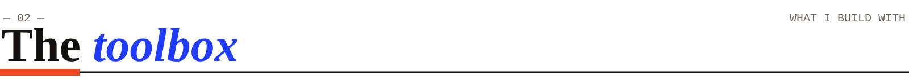

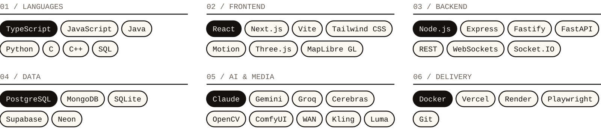

 

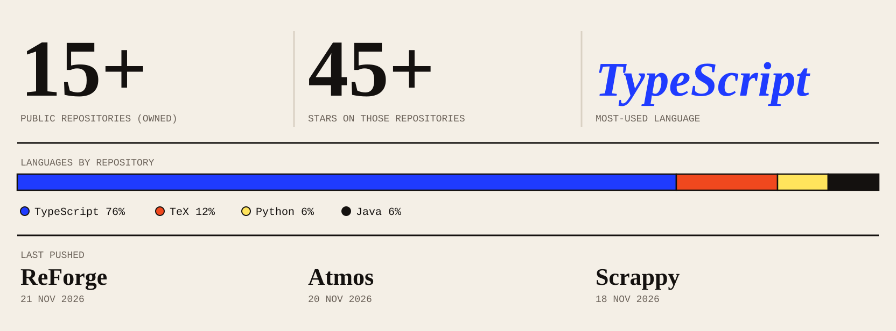

<picture>
  <source media="(prefers-color-scheme: dark)" srcset="https://raw.githubusercontent.com/Crusty-chirayu/Crusty-chirayu/output/github-contribution-grid-snake-dark.svg" />
  <source media="(prefers-color-scheme: light)" srcset="https://raw.githubusercontent.com/Crusty-chirayu/Crusty-chirayu/output/github-contribution-grid-snake.svg" />
  
</picture>

 

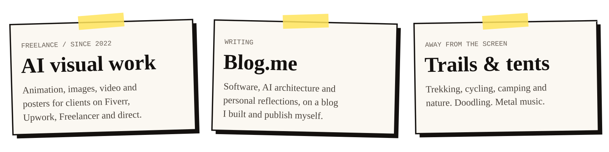

Read the blog: <a href="https://blog-me-mauve.vercel.app/"><b>Blog.me ↗</b></a>

 

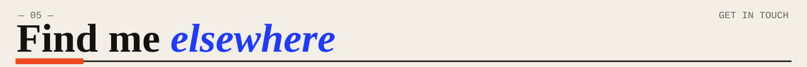

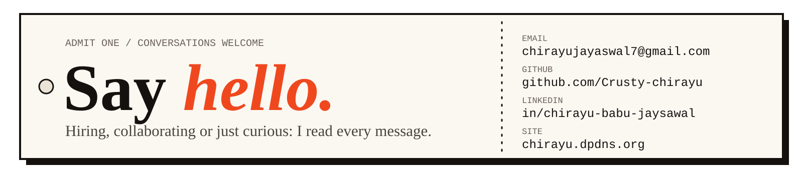

 

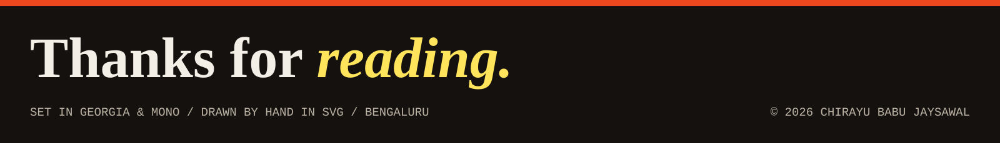